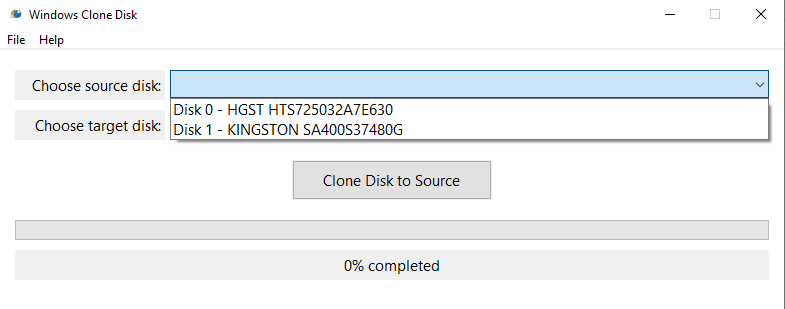
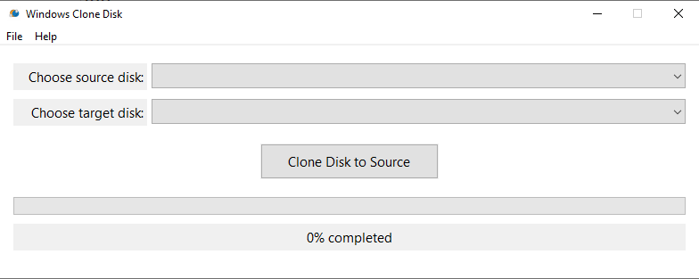

# Windows Disk Clone

A native Windows desktop utility written in C++ that copies raw bytes from one physical disk to another. It uses the Win32 API for its interface, WMI for disk discovery, and synchronous, unbuffered I/O on `\\.\PhysicalDriveN` devices for copying.

**Status:** experimental, based on a source review of commit `c67078d`. The implementation has unresolved disk-safety and correctness problems. A success dialog or a progress bar at 100% does not currently prove that the destination is a complete, usable clone. See [Current problems](docs/CURRENT_PROBLEMS.md).

**Destructive operation:** the program attempts to take the target disk offline and delete its partition layout before copying. Use only disposable test disks with independent backups. This is not a verified backup or recovery tool.

## Features and scope

- Select source and target physical disks by disk number and WMI device caption.
- Refresh the disk lists through **File > Refresh** or **F5**.
- Reject selection of the same disk as both source and target.
- Display overwrite and smaller-target warnings.
- Copy on a worker thread using a nominal 4 MiB buffer, with percentage progress and a completion/error dialog.
- Request administrator privileges through the executable manifest.

The program copies disk contents without interpreting filesystems. It has no image-file import/export, partition selection, filesystem-aware resizing, source snapshot, read-back verification, cancellation, or resume support. A smaller target is permitted after a warning; the worker then copies only the smaller disk's capacity, which can truncate partitions and data. A larger target does not automatically gain larger partitions or corrected end-of-disk metadata.

## Screenshots





These are repository screenshots; they are not evidence of current runtime validation.

## Build

The checked-in solution targets Visual Studio 2022, the MSVC **v143** toolset, and the **Windows 10 SDK** (`WindowsTargetPlatformVersion` is `10.0`). Install the Visual Studio **Desktop development with C++** workload with those components.

1. Open [WindowsCloneDisk.sln](WindowsCloneDisk.sln).
2. Choose **Debug** or **Release**, and **x64** or **x86**.
3. Build the solution. The project maps solution `x86` to project `Win32`.

Alternatively, from a Visual Studio Developer PowerShell in the repository root:

```powershell
msbuild .\WindowsCloneDisk.sln /m /p:Configuration=Release /p:Platform=x64
```

Find the executable through Visual Studio's build output or the project's evaluated `TargetPath`; the repository does not define a custom output directory. Launching the executable requests elevation.

The project links `shlwapi.lib`, `propsys.lib`, `wbemuuid.lib`, and `comsuppw.lib` in addition to inherited Windows libraries. There is no package-manager dependency setup, installer, automated test suite, or CI configuration in this checkout. A minimum supported Windows version and tested device/sector-size matrix are not documented.

## Interface workflow

For a controlled test with disposable disks:

1. Launch the built application and accept the administrator prompt.
2. Select the disk to read under **Choose source disk** and the disk to overwrite under **Choose target disk**. Verify their numbers independently; the UI shows no capacities or serial numbers.
3. The current action button is labeled **Clone Disk to Source**. Despite that wording, the code reads the source selection and writes the target selection.
4. Review the overwrite prompt. Avoid the smaller-target path: it truncates the copy rather than resizing the filesystem.
5. Independently verify the result before relying on it. There is no safe cancellation/shutdown protocol implemented.

## Project documentation

- [Architecture](docs/ARCHITECTURE.md): components, data structures, execution flow, and ownership.
- [Current problems](docs/CURRENT_PROBLEMS.md): prioritized source findings, consequences, and suggested repairs.

The documentation describes the checked-in implementation. It does not claim a successful build or disk-cloning test.

## Suggested GitHub metadata

Description:

> Experimental C++/Win32 disk-cloning utility for Windows, with WMI disk discovery, raw disk copying, and progress tracking.

Topics:

```text
windows cpp win32 disk-cloning raw-disk disk-utility wmi storage visual-studio
```

These are suggested repository settings; documenting them here does not update GitHub.

## License

[MIT](LICENSE), copyright 2026 IvanVenkov712.
