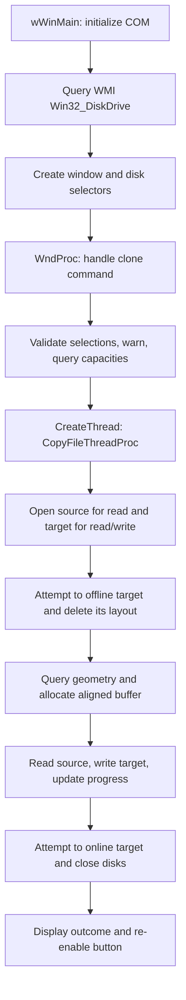

# Architecture

This document describes commit `c67078d` from static source inspection. The application is one native Windows GUI executable with two C++ translation units. There is no service, driver, separate copying library, or external backend.

## Components

| Component | Responsibility | Main entry points |
| --- | --- | --- |
| [WindowsCloneDisk.cpp](../WindowsCloneDisk/WindowsCloneDisk.cpp) | Startup, window/control creation, user commands, validation, copying, progress, and dialogs | `wWinMain`, `InitControls`, `WndProc`, `CopyFileThreadProc`, `ShowErrorMessage` |
| [HandleDisk.cpp](../WindowsCloneDisk/HandleDisk.cpp) | WMI enumeration, combo-box population, physical-device handles, geometry queries, and disk state changes | `GetLocalDiskCBEntries`, `FillComboBoxEntries`, `OpenDisk`, `GetDiskSizeInfo`, `PrepareDiskForWrite`, `PrepareDiskForUse` |
| [HandleDisk.h](../WindowsCloneDisk/HandleDisk.h) | Disk record types and helper declarations | `CBDISKENTRY`, `DISKSIZEINFO` |
| [WindowsCloneDisk.rc](../WindowsCloneDisk/WindowsCloneDisk.rc), [resource.h](../WindowsCloneDisk/resource.h), icons | Menu, F5 accelerator, About dialog, application strings, icons | Resource identifiers used by the window code |
| [WindowsCloneDisk.h](../WindowsCloneDisk/WindowsCloneDisk.h), [framework.h](../WindowsCloneDisk/framework.h), [targetver.h](../WindowsCloneDisk/targetver.h) | Common Controls manifest dependency, shared Windows/COM headers, SDK targeting | Compile/link configuration |
| [WindowsCloneDisk.vcxproj](../WindowsCloneDisk/WindowsCloneDisk.vcxproj) | Unicode Windows application, v143 toolset, x86/x64 configurations, native libraries, required elevation | MSBuild project |

The separation is partial: the disk helper also renders combo-box entries, and the copy worker lives in the GUI source file and receives window handles. The copy operation cannot currently be exercised independently of the interface without refactoring.

## Execution flow



This diagram shows the intended main path. Error handling and cleanup do not reliably establish successful completion; see [Current problems](CURRENT_PROBLEMS.md).

### Startup and discovery

`wWinMain` initializes COM as a single-threaded apartment and calls `GetLocalDiskCBEntries` before creating the main window. Discovery connects to `ROOT\CIMV2` and runs `SELECT * FROM Win32_DiskDrive`.

`GetLocalDiskCBEntries` first asks for a disk count, allocates a process-heap array, and calls discovery again to fill it. Each `FillComboBoxEntries` call counts the WMI results, resets the enumerator, and optionally reads `Index` and `Caption`. The UI displays entries as `Disk N - Caption`. Refresh repeats this process and replaces both lists.

### Validation and worker launch

The clone command reads the selected list indices, displays a generic overwrite confirmation, rejects equal physical disk numbers, and queries both capacities. A smaller target triggers another confirmation rather than a hard rejection.

The UI allocates `COPYFILETHREADPARAMS`, copies the physical disk numbers and control handles into it, and starts a Windows thread. These are disk numbers, not open device handles or stable device identifiers. The worker disables the action button after it starts; other controls and window exit remain available.

### Disk access and copying

`OpenDisk` builds `\\.\PhysicalDriveN`, calls `CreateFileW` with shared read/write access and `FILE_FLAG_NO_BUFFERING`, and seeks to offset zero. The source uses `GENERIC_READ`; the target uses `GENERIC_READ | GENERIC_WRITE`.

`PrepareDiskForWrite` attempts to persist the target's offline attribute with `IOCTL_DISK_SET_DISK_ATTRIBUTES`, then delete its partition layout with `IOCTL_DISK_DELETE_DRIVE_LAYOUT`. If layout deletion fails, it attempts to clear the offline attribute. This preparation precedes the worker's geometry queries and buffer allocation, so later setup failures may follow destructive changes.

The worker obtains capacities and geometry sector sizes through `IOCTL_DISK_GET_DRIVE_GEOMETRY_EX`, allocates a 4 MiB buffer plus alignment slack, and aligns its usable address to the larger reported sector size. The planned copy length is:

```text
copySize = min(source capacity, target capacity)
```

Synchronous `ReadFile` and `WriteFile` calls transfer consecutive bytes. After each write, progress is calculated from `writtenTotal / copySize`; the buffer length is reduced for the remainder. No filesystem, partition table, encryption, or boot metadata is interpreted or repaired.

### Completion

After successful target preparation, the worker attempts to clear the target's offline attribute even if a later step fails. It closes both device handles when both initially opened successfully, chooses a dialog using `isOK` and the current thread's last-error value, unconditionally displays 100%, re-enables the button, and frees its parameter block.

There is no read-back comparison, explicit flush, partition growth, GPT relocation, cancellation handshake, or retained operation result. Returning the target online does not verify its contents or guarantee that Windows can mount it.

## State and ownership

| State/resource | Intended owner and lifetime | Current caveat |
| --- | --- | --- |
| `availableDrives`, `availableDrivesCount` | UI globals; replaced during refresh | Allocation failure can lose the old pointer; no final array cleanup |
| `CBDISKENTRY` | One physical disk number and a fixed 64-character caption | No serial number, capacity, or persistent identity |
| `DISKSIZEINFO` | Stack record containing capacity and geometry `BytesPerSector` | Does not distinguish logical and physical alignment requirements |
| `COPYFILETHREADPARAMS` | Allocated by UI, freed by worker or failed-launch path | Failed `CreateThread` is checked against the wrong failure value |
| Source/target handles and copy buffer | Worker, for one operation | Partial-open failure leaks a successfully opened handle |
| Worker thread handle | Created in `WndProc` | Not retained, joined, or closed |
| WMI objects and UI font | Discovery helpers and UI initialization | Enumerator and font are not released |

The worker communicates directly with controls using `SendMessage`, `SetWindowText`, and `EnableWindow`, and displays its own message boxes. There is no application-level job state machine or UI-thread message protocol for progress and completion. `WM_DESTROY` immediately posts quit without coordinating with the worker.

## Architectural improvement direction

Separate disk discovery, a copy engine, and the UI. The engine should accept validated device handles and a copy plan, return an explicit result with the failing stage/error and transferred byte count, and expose progress/cancellation independently of window handles. Keep job state and control updates on the UI thread. Use scoped owners for handles, heap allocations, and COM interfaces.

These are proposed changes, not features of the current implementation. The [problem list](CURRENT_PROBLEMS.md) identifies which correctness and safety fixes should precede that refactoring.
